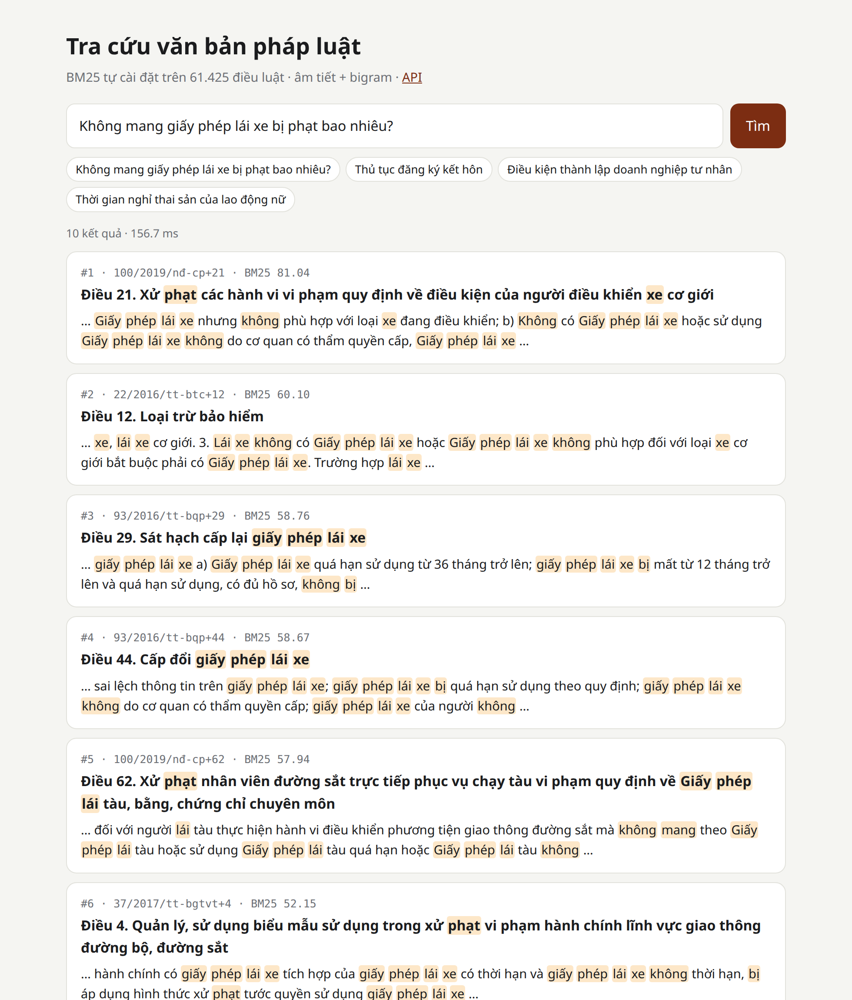
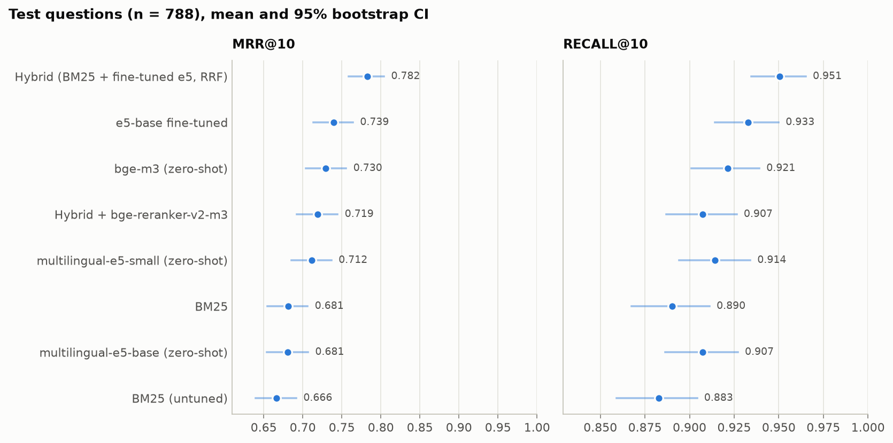
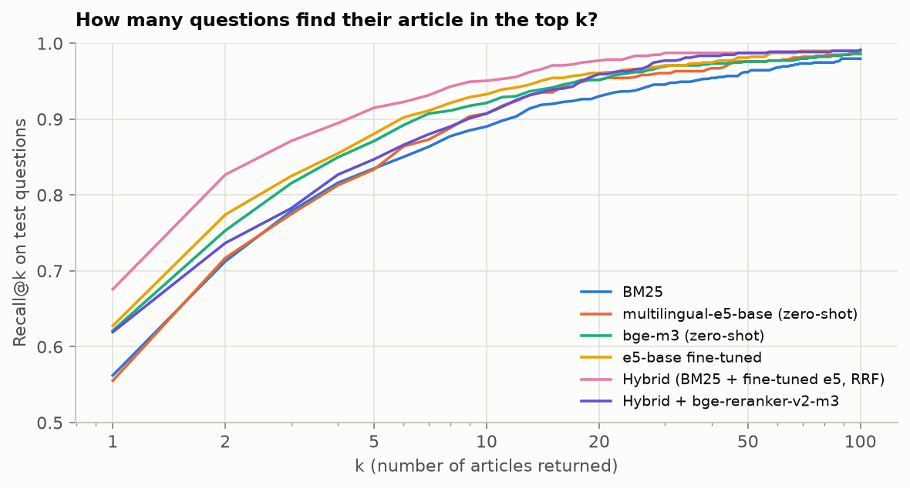
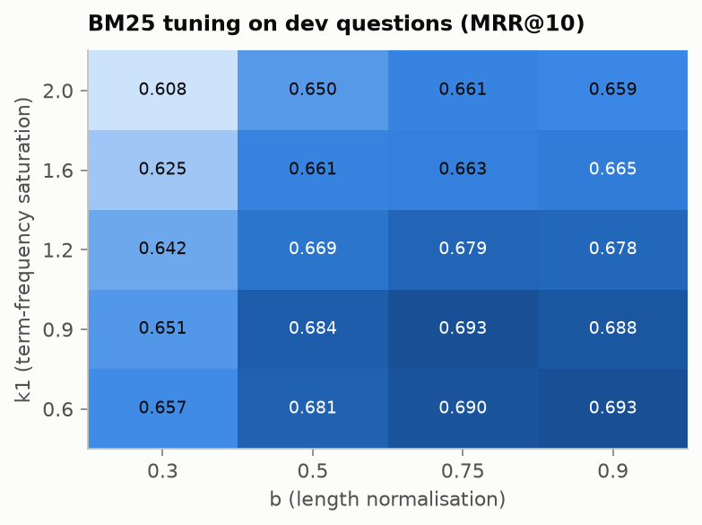

# vietnamese-legal-retrieval

[](https://github.com/hoang-stack/vietnamese-legal-retrieval/actions/workflows/ci.yml)


**Finding the article of Vietnamese law that answers a citizen's question, among 61,425
articles: BM25 written from scratch, three multilingual embedding models, a fine-tuned
retriever, hybrid fusion and a cross-encoder reranker, all scored by the same code on the same
held-out questions.**

This is the retrieval half of a legal question-answering (RAG) system. If the right article
is not retrieved, no language model can answer from it. Questions are everyday ("Công an xã có
được xử phạt lỗi không mang bằng lái xe không?"), while the articles are written in legal
language, so lexical and semantic matching both matter.



## Results

788 test questions, used once. Every number comes from the same evaluation code, with 95%
bootstrap CIs over questions.

| System | MRR@10 (95% CI) | nDCG@10 | Recall@1 | Recall@10 | Recall@100 |
| --- | ---: | ---: | ---: | ---: | ---: |
| **Hybrid: BM25 + fine-tuned e5 (RRF)** | **0.782** (0.759–0.804) | **0.824** | **0.676** | **0.951** | **0.991** |
| e5-base, fine-tuned here | 0.739 (0.713–0.764) | 0.786 | 0.628 | 0.933 | 0.990 |
| BGE-M3, zero-shot | 0.730 (0.704–0.756) | 0.776 | 0.621 | 0.921 | 0.986 |
| Hybrid + bge-reranker-v2-m3 | 0.719 (0.692–0.745) | 0.764 | 0.619 | 0.907 | 0.991 |
| multilingual-e5-small, zero-shot | 0.712 (0.685–0.737) | 0.761 | 0.591 | 0.914 | 0.988 |
| **BM25, from scratch** (tuned) | 0.681 (0.655–0.706) | 0.732 | 0.562 | 0.890 | 0.980 |
| multilingual-e5-base, zero-shot | 0.681 (0.654–0.707) | 0.736 | 0.555 | 0.907 | 0.986 |
| BM25 (k1 = 1.2, b = 0.75) | 0.666 (0.640–0.692) | 0.719 | 0.542 | 0.883 | 0.980 |



### Takeaways

1. **Lexical and semantic retrieval are complementary.** Fusing BM25 with the fine-tuned
   bi-encoder by rank alone (RRF, no tuning) beats every single system: +0.101 MRR@10 over BM25
   and +0.043 over the fine-tuned bi-encoder (paired bootstrap, p < 0.001 for every
   comparison). 95% of questions find their article in the top 10.
2. **One line of tokenisation is worth as much as a neural model.** Adding syllable bigrams
   lifts BM25 from 0.584 to 0.679 MRR@10 on dev. The tuned BM25 then matches zero-shot
   multilingual-e5-base on test (0.681 vs 0.681).
3. **Fine-tuning on 1,926 questions helps.** multilingual-e5-base goes from 0.681 to 0.739 on test.
   On dev it was still improving after the third and last epoch (0.728 → 0.738 → 0.745).
4. **A general-purpose reranker made things worse.** The bge-reranker-v2-m3 cross-encoder,
   used zero-shot on articles truncated to 2,000 characters, dropped MRR@10 from 0.782 to 0.719.
   The same thing happened on dev (0.788 → 0.775), which is why it was not used. A reranker would
   need fine-tuning on this domain.
5. **Bigger is not always better zero-shot.** multilingual-e5-small (118M parameters) beats
   e5-base (278M) out of the box. BGE-M3 (568M) is the best zero-shot model, but it needs 3× the
   GPU time of e5-base to embed the corpus.



## Systems

| System | What it is | Where it runs |
| --- | --- | --- |
| **BM25** ([bm25.py](src/vilegal/bm25.py)) | Okapi BM25 over syllables + syllable bigrams, from scratch on a SciPy sparse matrix; k1, b tuned on dev | CPU, ~3 ms per query in batches |
| multilingual-e5-small / -base | Zero-shot bi-encoders (Wang et al., 2024) | Kaggle T4 |
| BGE-M3 | Zero-shot multilingual bi-encoder (Chen et al., 2024) | Kaggle T4 |
| e5-base fine-tuned | InfoNCE with in-batch negatives + one BM25 hard negative per question; epoch chosen on dev | Kaggle T4 |
| Hybrid | Reciprocal rank fusion of BM25 and the fine-tuned e5 (Cormack et al., 2009) | – |
| Hybrid + reranker | bge-reranker-v2-m3 cross-encoder re-scores the hybrid top-50 | Kaggle T4 |

Long articles (up to 55,000 syllables) are split into overlapping 220-syllable passages for the
bi-encoders, and an article scores as its best passage (MaxP).

**Why syllable bigrams?** Vietnamese words are mostly two syllables written with a space
("giấy phép", "lái xe"). A word segmenter is the usual fix. Indexing adjacent-syllable pairs is
a dependency-free stand-in that captures most of the benefit (see the tokenisation table in
[`reports/results.md`](reports/results.md)).

## Evaluation protocol

- **Data:** [Zalo AI 2021 Legal Text Retrieval](https://huggingface.co/datasets/GreenNode/zalo-ai-legal-text-retrieval-vn)
  (MIT): 61,425 articles, 3,298 questions, about one relevant article per question.
- **Leak removed:** 24 questions appear in both the official train and test sets. They are
  dropped from training.
- **Splits:** 1,926 train questions (fine-tuning only), 482 dev questions (every choice: BM25
  parameters, epochs, fusion), and the 788 official test questions, used once at the end.
- **Metrics:** MRR@10, nDCG@10, Recall@1/5/10/100, with 95% bootstrap CIs over questions and
  paired bootstrap tests between systems. The neural runs only write rankings on Kaggle, and
  every number is computed locally by the same evaluation code.

## Analysis

### BM25 (dev questions)

| Tokenisation | Vocabulary | MRR@10 | Recall@10 | Recall@100 |
| --- | ---: | ---: | ---: | ---: |
| Syllables | 11,610 | 0.584 | 0.800 | 0.927 |
| Syllables + bigrams | 447,687 | 0.679 | 0.863 | 0.964 |
| + tuned k1 = 0.9, b = 0.75 | 447,687 | **0.693** | 0.859 | 0.962 |



Legal articles vary a lot in length, so length normalisation matters (b ≥ 0.75). The optimum
is flat around k1 = 0.6–0.9.

### Cost (Kaggle T4 GPU, 61,425 articles = 120,554 passages)

| Step | Time |
| --- | ---: |
| BM25 index (CPU) | 24 s |
| Embed corpus: e5-small / e5-base / BGE-M3 | 2.8 / 6.8 / 20.6 min |
| Fine-tune e5-base, one epoch (1,926 questions) | ~1 min |
| Rerank top-50 for 1,270 questions | 21.5 min (~1 s per question) |

## Quickstart

```bash
git clone https://github.com/hoang-stack/vietnamese-legal-retrieval.git
cd vietnamese-legal-retrieval
python -m venv .venv && source .venv/bin/activate
pip install -e ".[dev]"

pytest                                      # unit tests, no download
vilegal search "không mang giấy phép lái xe bị phạt bao nhiêu"   # downloads data (35 MB) on first use
vilegal serve                               # search page at http://127.0.0.1:8000
vilegal experiments bm25                    # BM25 tokenisation + parameter grid + test
```

The neural systems run on a free Kaggle GPU:
[`kaggle/dense_retrieval.py`](kaggle/dense_retrieval.py) reads a dataset made of `data/raw`,
`src/` and `splits.json`, and writes `runs.json` (rankings). Download it to
`kaggle/output/main/`, then run `vilegal experiments neural` and `vilegal report`.

## Project layout

```text
src/vilegal/
├── data.py          download + checksums, the 24-question leak, train/dev/test splits
├── text.py          NFC, syllables, syllable bigrams
├── bm25.py          BM25 on a sparse matrix, re-weighting without re-indexing
├── fusion.py        reciprocal rank fusion
├── metrics.py       MRR, nDCG, Recall@k, bootstrap CIs, paired bootstrap
├── search.py        search service with best-window snippets
├── experiments.py   evaluates BM25 and the Kaggle runs with the same code
├── report.py, api.py, cli.py, static/index.html
kaggle/dense_retrieval.py   bi-encoders, fine-tuning, hybrid, reranking (PyTorch, T4 GPU)
```

## Limitations

- **Missing labels.** Most questions have exactly one labelled article, but other articles can
  also answer them. Such hits count as misses, so all scores are lower bounds.
- **Edge of the search space.** Fine-tuning ran for three epochs, and the best dev score was at
  the last one. Longer training may help. The fine-tuned run uses a single seed.
- **The reranker was not adapted.** It was used zero-shot, on truncated articles. A reranker
  fine-tuned on these questions is the obvious next step and likely the largest remaining gain.
- **The demo is BM25 only.** The neural systems need a GPU to embed the corpus, so the CPU
  search page uses the from-scratch BM25.
- **Licence.** The Hugging Face copy of the Zalo data declares an MIT licence. The original
  challenge terms were not checked.

## References

- Robertson, S., Zaragoza, H. (2009). The probabilistic relevance framework: BM25 and beyond.
- Wang, L. et al. (2024). Multilingual E5 text embeddings: a technical report. *arXiv:2402.05672.*
- Chen, J. et al. (2024). BGE M3-Embedding: multi-lingual, multi-functionality, multi-granularity text embeddings. *arXiv:2402.03216.*
- Karpukhin, V. et al. (2020). Dense passage retrieval for open-domain question answering. *EMNLP.*
- Dai, Z., Callan, J. (2019). Deeper text understanding for IR with contextual neural language modeling (MaxP). *SIGIR.*
- Cormack, G., Clarke, C., Büttcher, S. (2009). Reciprocal rank fusion outperforms Condorcet and individual rank learning methods. *SIGIR.*
- Nogueira, R., Cho, K. (2019). Passage re-ranking with BERT. *arXiv:1901.04085.*
